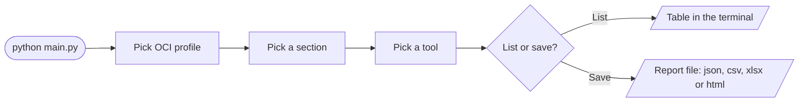

<div align="center">

# 🧰 OCI Power Tools

**Answer the questions the OCI Console and CLI can't.**

Find *everything a user is actually allowed to do*, or list resources *across every compartment* — then print them as a table or export them to CSV, JSON, Excel or a spreadsheet-style web page.


[Why](#-why) · [Tools](#-tools) · [Getting started](#-getting-started) · [Reports](#-reports) · [IAM](#-required-iam-permissions) · [Contributing a tool](#-adding-a-tool)

</div>

> [!NOTE]
> This project is just getting started. New tools are added over time, focused on gaps in the official tooling.

---

## 🤔 Why?

Some questions are surprisingly hard to answer in OCI:

| You ask | What OCI gives you | What this tool gives you |
|---|---|---|
| *"What can this user do?"* | The user's groups, and separately a list of policies. Nothing joins the two. | One table: group → policy → statement, across all compartments |
| *"Show me all VMs in the tenancy"* | Console and CLI work one compartment at a time | Every VM and its block volumes in one table |
| *"Send me that as a spreadsheet"* | Copy and paste | `csv`, `json`, `xlsx` or a spreadsheet-style `html` page in `reports/` |

---

## 🧭 How it works



Every tool does one thing: it fetches data from OCI and returns a **pandas DataFrame**. A single wrapper then decides whether to print it (with `tabulate`) or write it to a report — so every tool supports both, with no extra code.

---

## 🛠 Tools

> [!IMPORTANT]
> All tools are **read-only**. Nothing in your tenancy is created, changed or deleted.

| Section | Tool | You get |
|---|---|---|
| 🪪 **Identity** | Groups | Every group in the tenancy, with description, state and creation time |
| | Users in all groups | `group_name`, `group_id`, `user_name`, `user_id` for every membership |
| | Users in a group | The same, for groups whose name contains your search text |
| | All policies | Every policy statement, with its compartment and policy name |
| | ⭐ **Permissions of a user** | Policy statements that apply to the groups a user belongs to ([details](#permissions-of-a-user)) |
| ☸️ **Container Engine** | All clusters | Clusters in every compartment, with Kubernetes version |
| 🖥 **Virtual Machines** | All VMs in the tenancy | One row per VM and attached block volume (`--` when a VM has none) |
| | VMs in a compartment | The same, for a compartment you pick |
| | VMs by tag | VMs in a compartment you pick that match a tag key and one or more values |
| 🛡 **Web App Firewall** | WAF policies in a compartment | Policies with domain and state |
| | Protection rules in a WAF policy | Rule name, action, description, labels |
| | Recommendations in a WAF policy | Recommended actions, description, labels |
| 📈 **Metrics** | All metrics | Metrics of a compartment you pick: namespace, name, resource group and dimensions |
| 🧾 **Audit** | Audit events of a resource | Who did what to a resource: events matching its OCID in a compartment you pick ([details](#audit-events)) |
| | Audit events of a user | Recent events performed by a user you search for, in one or all compartments ([details](#audit-events)) |

<a id="permissions-of-a-user"></a>

<details>
<summary><b>⭐ Permissions of a user</b> — how it works and its limits</summary>

<br>

Look up a user by name, email or OCID. The tool then:

1. Finds the groups the user belongs to.
2. Reads the policies in every compartment (root included).
3. Returns each statement (`allow group …` / `endorse group …`) that mentions one of those groups, together with its compartment and policy name.

**Keep these in mind when reading the output:**

- Groups are matched by **name** inside the statement text. A short group name (e.g. `dev`) also matches statements for longer names (e.g. `developers`), and a group name that only appears in a `where` condition also matches. Review results before acting on them.
- Only `allow group` and `endorse group` statements are considered. Dynamic groups, `any-user`, and group references by OCID are not covered.

</details>

<a id="audit-events"></a>

<details>
<summary><b>🧾 Audit events</b> — how they work and their limits</summary>

<br>

Both tools ask which **regions** to search (the regions the compartments are using, or one you pick), a **time window** (last hour, 24 hours, 7 days, 30 days, or a custom number of days) and whether to include **read events**. Read events (`GET` / `HEAD`) are hidden by default because they make up most of the log. Results are shown newest first.

- **Audit events of a resource**: enter the resource OCID and pick the compartment it lives in (the tenancy root is in the list). If the OCID contains a region (e.g. `uk-london-1`) only that region is searched. Events whose resource or request path contains that OCID are returned.
- **Audit events of a user**: search for the user as in *Permissions of a user*, then scan **all compartments** or **one**. Events performed by that user are returned.

**Keep these in mind:**

- The OCI Audit API can only be queried one compartment at a time, and cannot filter by resource or user. The tools download the events of each compartment and filter them here, so scanning all compartments over a long window can take a while. The time window is fetched in parallel slices and a running count of events is shown while it works.
- A resource is logged in the compartment it had when the action happened. If it was moved, or you pick the wrong compartment, events can be missing.
- **Audit events are stored per region.** Changes to a resource are logged in the region where the resource lives, so searching only the profile's region misses them. The tools find the regions in use from the last 30 days of cost data, which is much faster than querying every subscribed region. Resources that cost nothing don't show up there, so if you expect events and get none, pick the region yourself. If the cost data can't be read you are asked to pick a region.
- OCI keeps audit events for 90 days by default (up to 365 if your tenancy extends it).
- Users are matched by their OCID, so only users known to the IAM API are found. Compartments you cannot read are skipped with a message.

</details>

<details>
<summary><b>⚠️ Known limitations</b></summary>

<br>

- A tool that finds nothing prints `No results found.` and does not create a report file.

</details>

---

## 🚀 Getting started

### Requirements

- 🐍 **Python 3.12** or newer
- 🔑 An OCI account with an API signing key and a config file — see [OCI SDK and CLI configuration](https://docs.oracle.com/en-us/iaas/Content/API/Concepts/sdkconfig.htm)
- 👀 Read access to the resources you want to report on — see [Required IAM permissions](#-required-iam-permissions)

### Install

```bash
git clone https://github.com/RahalAmrith/oci-power-tools.git
cd oci-power-tools

python -m venv env
source env/bin/activate        # Windows: env\Scripts\activate

pip install -r requirements.txt
```

### Configure OCI access

The tool reads a standard OCI config file:

1. If `~/.oci/config` exists (the OCI CLI default), it is used automatically.
2. Otherwise a file picker opens so you can choose one.

```ini
[DEFAULT]
user=ocid1.user.oc1..xxxxxxxx
fingerprint=aa:bb:cc:...
tenancy=ocid1.tenancy.oc1..xxxxxxxx
region=ap-singapore-1
key_file=/path/to/your_private_key.pem
```

With more than one profile in the file, you are asked which one to use.

### Run

Run it from the project root — reports are written to `./reports` relative to where you launch it.

```bash
python main.py
```

<details open>
<summary><b>What a session looks like</b></summary>

<br>

```text
Using config file : /Users/you/.oci/config
Selected Profile : DEFAULT
Select option to continue :

Select a section :

        01 : Identity
        02 : Container Engine
        03 : Virtual Machines
        04 : Web App Firewall
        05 : Metrics
        06 : Audit
        00 : Exit

Enter option number : 1

====== Identity

        01 : Groups
        02 : Users in all groups
        03 : Users in a group
        04 : All policies
        05 : Permissions of a user
        00 : Back

Enter option number : 4

What do you want to do with the results?

        1 : List in the terminal
        2 : Save to a report file

Enter option number : 1

+---------------+-------------+-------------------------------------------------+
| Compartment   | Policy      | Statement                                       |
+===============+=============+=================================================+
| root          | NetworkRead | Allow group Network_RO to read virtual-network- |
|               |             | family in tenancy                               |
+---------------+-------------+-------------------------------------------------+
| Dev           | DevAccess   | Allow group Developers to manage instances in   |
|               |             | compartment Dev                                 |
+---------------+-------------+-------------------------------------------------+
```

Long text columns wrap, while ids and names stay on one line so you can copy them.

</details>

---

## 📄 Reports

Choosing **save** asks for a file name, then lets you pick the output format from a numbered list:

```text
Select the output format :

        1 : JSON
        2 : CSV
        3 : Excel (.xlsx)
        4 : HTML (spreadsheet style web page)
```

| Format | Output | Notes |
|---|---|---|
| CSV | `reports/<name>.csv` | |
| JSON | `reports/<name>.json` | A list of records |
| Excel | `reports/<name>.xlsx` | Optionally merges repeated cells, starting from the first column. Timestamps are written in UTC without a timezone, because Excel can't store one |
| HTML | `reports/<name>.html` | A single file that opens in any browser, no internet needed. See below |

### 🌐 The HTML report

The HTML format gives you a page that looks and behaves like a spreadsheet, which is handy for sharing results with someone who doesn't have the tool:

- Column letters (A, B, C…) and row numbers, with the header row and row numbers frozen while you scroll
- Click a cell to see its full value and address (like `C2`) in the formula bar above the grid, and move around with the arrow keys
- Click a column name to **sort** by it (click again to reverse); numbers sort as numbers and empty cells always go last
- A **filter** box that hides rows that don't contain your text, with a live row count
- Light and dark appearance that follows your system setting

It is one self-contained file: nothing is loaded from the internet and your data is never sent anywhere. Because it contains the full report, treat it like any other report and don't share it if it holds sensitive data.

The `reports/` folder is created on first run and is git-ignored.

---

## 🔐 Required IAM permissions

The user or group behind your API key needs read access to whatever you query. A starting point:

```text
Allow group <group> to inspect users in tenancy
Allow group <group> to inspect groups in tenancy
Allow group <group> to inspect policies in tenancy
Allow group <group> to inspect compartments in tenancy
Allow group <group> to read instances in tenancy
Allow group <group> to read volume-family in tenancy
Allow group <group> to read cluster-family in tenancy
Allow group <group> to read waas-family in tenancy
Allow group <group> to read metrics in tenancy
Allow group <group> to read audit-events in tenancy
Allow group <group> to read usage-report in tenancy
```

Narrow `tenancy` to a compartment if you only need part of the tenancy. Exact requirements vary by tool; if something returns an authorization error, check which resource type it touches.

---

## 🧩 Project structure

```text
oci-power-tools/
├── main.py                  # Section → tool menu
├── core/
│   ├── session.py           # Config file, profile and required directories
│   ├── menu.py              # Numbered menu
│   ├── prompts.py           # Shared pickers (compartment, user)
│   └── runner.py            # Runs a tool, then lists or saves its DataFrame
├── tools/
│   ├── __init__.py          # SECTIONS: the sections shown in the menu
│   ├── identity/            # groups, users, policies, user permissions
│   ├── container_engine/    # clusters
│   ├── compute/             # virtual machines
│   ├── waf/                 # web application firewall
│   ├── monitoring/          # metrics
│   └── audit/               # audit events of a resource or a user
├── helpers/
│   ├── ocisdk.py            # Wrapper around the OCI Python SDK
│   ├── htmlreport.py        # Builds the spreadsheet-style HTML report
│   └── utils.py             # Config parsing and report writing
├── requirements.txt
└── reports/                 # Generated output (git-ignored)
```

Each section folder holds one script per tool and an `__init__.py` that lists them. Code shared by a section's tools lives in its `_common.py`.

### ➕ Adding a tool

1. **Write the tool.** Add a script to a section folder (or a new folder for a new section) with a `run(ctx)` function that returns a pandas `DataFrame`. `ctx.ocisdk` is the SDK wrapper and `ctx.profile` the selected profile.

    ```python
    import pandas as pd


    def run(ctx):
        groups = ctx.ocisdk.getUserGroups(cfgName=ctx.profile)

        return pd.DataFrame.from_dict(groups)
    ```

2. **Register it.** Add `("Tool name", module.run)` to `getTools()` in the section's `__init__.py`. A new section also goes into `SECTIONS` in `tools/__init__.py`.

Listing, saving, empty results and errors are handled by `core/runner.py`. If a tool needs to stop early, for example when a user isn't found, raise `ToolAbort("message")` from `core/prompts.py`.

---

## 🔒 Security

- Your OCI config and private keys are read from your machine and never leave it; the tool only talks to the OCI APIs.
- `.gitignore` excludes `reports/` and `.env`. Reports can contain sensitive data (user emails, policy statements, resource names), so don't commit them. Keep your OCI config and keys outside the project folder (the default is `~/.oci`), since `.gitignore` no longer covers them.

## 🗺 Roadmap

More tools are planned, aimed at things OCI doesn't offer out of the box. Ideas and requests are welcome — open an issue.

---

<div align="center">

Made by [@RahalAmrith](https://github.com/RahalAmrith)

</div>
